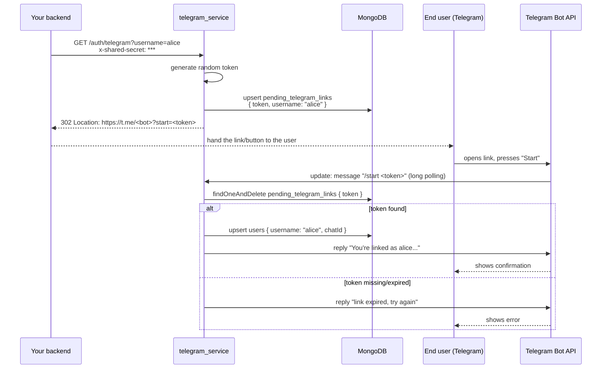
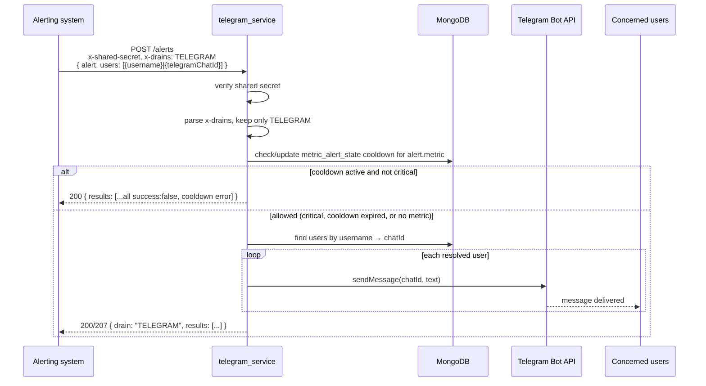

# Workflows

There are two independent flows: **linking** a user (one-time, per user) and **alerting** (repeated, per alert).

## 1. Linking flow (subscribe)

**Key points**
- The redirect (`302`) is what "lands the user on the bot" — the URL is a standard Telegram deep link (`https://t.me/<bot_username>?start=<payload>`), not anything custom.
- The token is single-use (`findOneAndDelete`) and expires after 10 minutes via MongoDB TTL if never used.
- Re-requesting a link for the same `username` invalidates any earlier unused token for that username (the upsert overwrites it).
- This step only needs to happen once per user, ever (unless they want to re-link, e.g. after blocking the bot).

## 2. Alerting flow (notify)

**Key points**
- `x-drains` lets the caller ask for multiple channels without this service erroring on ones it doesn't implement yet — anything besides `TELEGRAM` comes back under `skipped`.
- Users can be named by `username` (resolved via Mongo — the normal case, populated by the linking flow above) or by a raw `telegramChatId` (an escape hatch if the caller already has one).
- Delivery is per-user and independent: one user's failure (unlinked username, blocked bot, bad chat id) doesn't stop delivery to the others. The response reports success/failure per user, and the HTTP status is `207` if any user failed, `200` if all succeeded.
- Non-critical alerts are throttled per `alert.metric`: a repeat within `DEFAULT_COOLDOWN_SECONDS` is accepted but not delivered (every user comes back `success: false` with a cooldown error). `severity: "critical"` always bypasses this. See [mental-model.md](./mental-model.md) and [api-reference.md](./api-reference.md).

## Putting it together

The linking flow only needs to run once per user; after that, every alert for that user's `username` just works. A typical rollout:

1. Add a "Connect Telegram" action in your product that calls your backend, which calls `GET /auth/telegram?username=<user>` and redirects the browser to the `t.me` link it gets back.
2. User presses Start once.
3. From then on, your alerting system calls `POST /alerts` with `{ "username": "<user>" }` whenever that user needs to be notified — no further linking needed.
